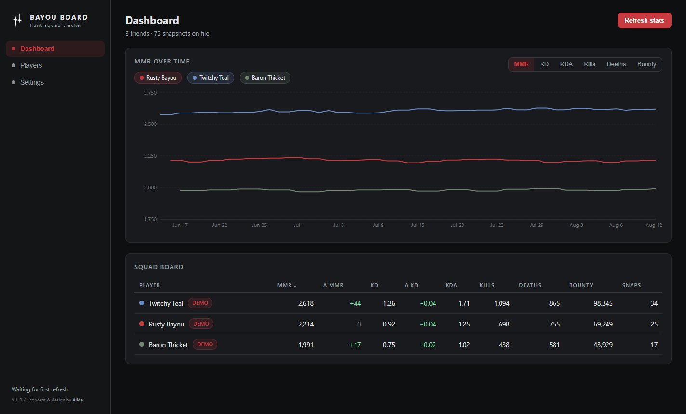
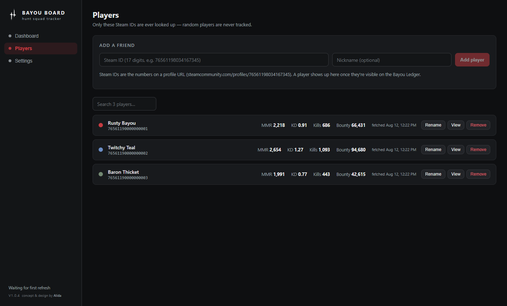
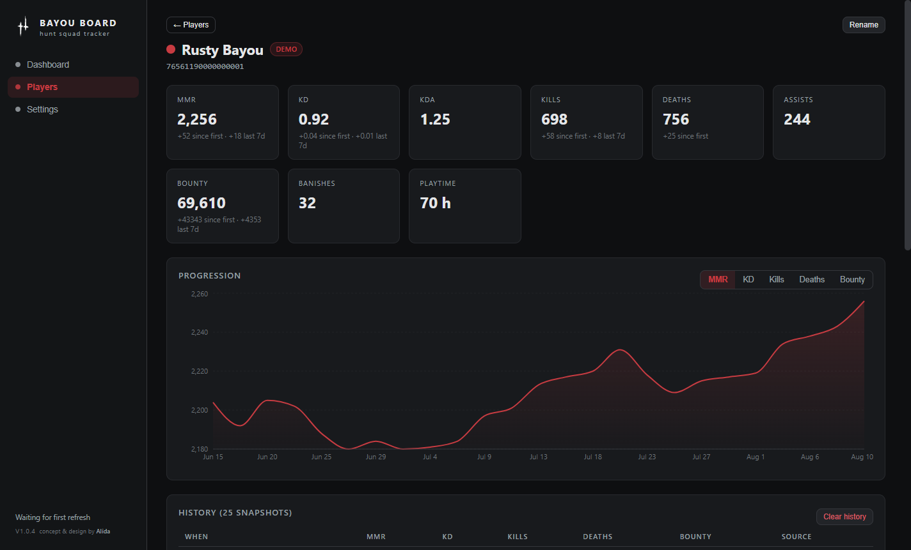
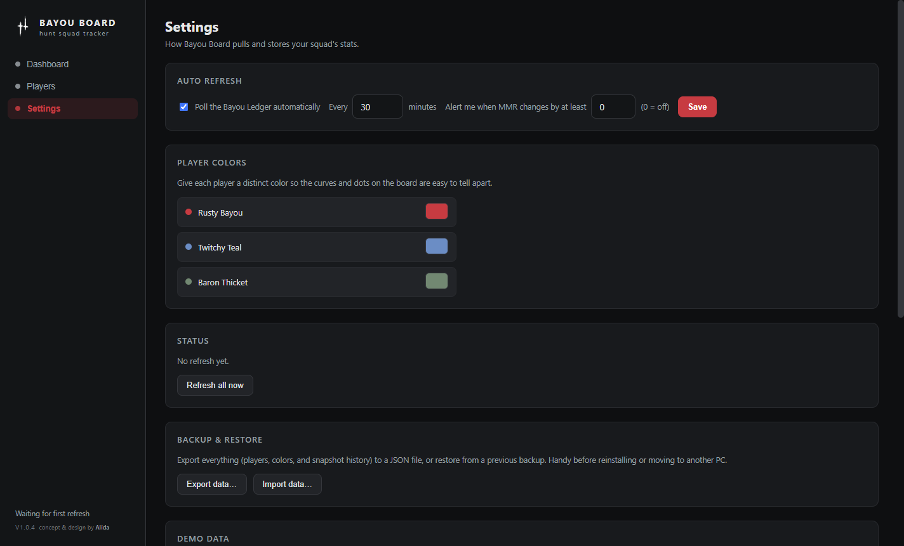

# Bayou Board

Track your Hunt: Showdown 1896 squad's stats over time — MMR, KD, KDA, kills, deaths and bounty, as progression graphs instead of a single snapshot.

Bayou Board is an unofficial, free, open-source Windows app. It pulls each player's public stats by Steam ID and builds a private history on your own machine.

> **Not affiliated with Crytek.** Hunt: Showdown is a trademark of Crytek GmbH.

## Screenshots

| Dashboard | Squad & progression |
| --- | --- |
|  |  |

| Player detail | Settings |
| --- | --- |
|  |  |

## Features

- **MMR over time** — multi-player chart with MMR / KD / KDA / Kills / Deaths / Bounty views. Click a legend pill to hide or show a player's curve.
- **Squad board** — one glance at everyone's MMR, KD, KDA, kills, deaths, bounty and snapshot count. Click any column header to sort.
- **Player pages** — 9 stat cards with lifetime and last-7-days deltas, a progression chart, and the full snapshot history.
- **Auto refresh** — polls the Bayou Ledger every N minutes (configurable) and records a snapshot whenever stats change. MMR-change notifications are optional.
- **Player colors** — every player gets their own curve color; pick any color in Settings.
- **Manual snapshots** — log a friend's numbers by hand when they're not on the Ledger yet.
- **Demo data** — load a few generated players to see the app in action immediately.
- **Backup & restore** — export your whole history to JSON, or import it on another PC.
- **Tray** — closes to the tray and keeps tracking; optional launch at Windows login.

## Install

Download the latest installer from the **Releases** page and run it. No accounts, no cloud — everything stays on your machine.

Then in the app:

1. Open **Players → Add a friend** and paste a Steam ID (the 17-digit number from `steamcommunity.com/profiles/…`). Add your own too.
2. Hit **Refresh stats** (or let auto-refresh do it).
3. A player appears once they're visible on the Bayou Ledger — they need a public Steam profile, the in-game "hide stats" switch off, and stats registered on the Ledger.

## How stats work

Stats come from [The Bayou Ledger](https://bayouledger.com), a fan-made tracker that mirrors each player's public in-game stats. Bayou Board only ever fetches the Steam IDs you add — it never browses lobbies or random players. Sign in with Steam on the Ledger once if you want *your* profile tracked.

## Privacy

- All data is stored locally in the app's data folder (`data.json`). Nothing is uploaded by Bayou Board.
- Stats are only fetched for players you explicitly add.
- Use **Settings → Backup & restore** to export or wipe data.

## Development

```
npm install
npm run dev        # start in dev mode
npm run typecheck  # typecheck main + renderer
npm run build      # build to out/
npm run dist       # package a Windows installer into dist/
```

Stack: Electron + React + TypeScript, built with electron-vite, charts by recharts.

## Credits

- Concept and design by Alida.
- Stats powered by [The Bayou Ledger](https://bayouledger.com).
- Built for the Hunt: Showdown community. Happy hunting.

## License

[MIT](LICENSE)
